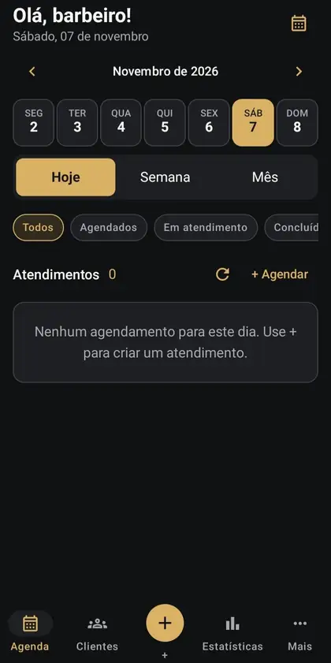
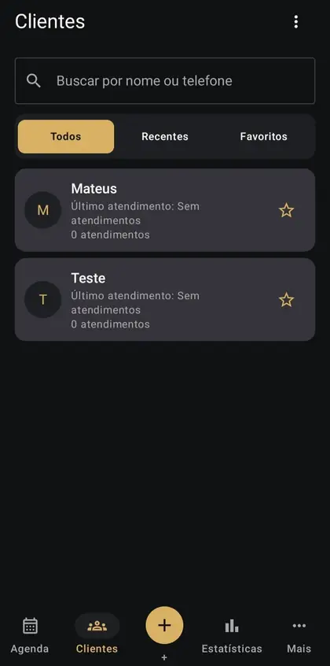
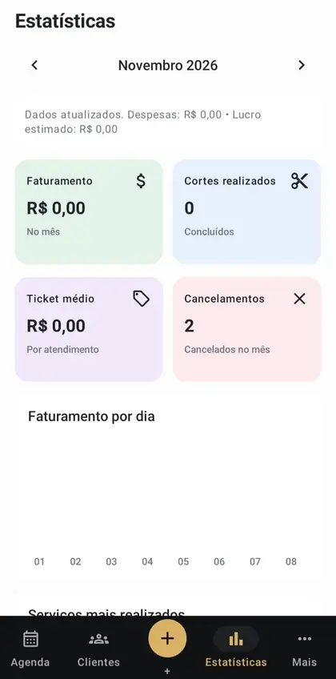
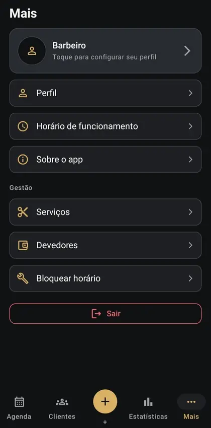

<div align="center">

# Agenda Barber

**Agenda, clientes e resultados em um único aplicativo Android para barbeiros.**

Aplicativo interno, sem portal do cliente e sem agendamento público. O profissional controla os horários, registra atendimentos e acompanha os resultados financeiros.

**Versão 1.0.0 · Android nativo · Kotlin + Jetpack Compose · Java 21 + Spring Boot · PostgreSQL**

[Ver telas](docs/SCREENS_GALLERY.md) · [Arquitetura](docs/ARCHITECTURE.md) · [Executar e testar](docs/DEVELOPMENT.md) · [Lançamento](docs/RELEASE_1_0_0_RUNBOOK.md)

</div>

> **Estado do projeto (07/11/2026):** MVP v1.0.0 implementado e validado em testes automatizados. API publicada na AWS EC2 com HTTPS; APK de produção assinado com a chave oficial e instalado para homologação no Samsung Galaxy Tab A7 Lite (SM-T220). A homologação funcional completa no dispositivo e o merge da [PR de release #52](https://github.com/tteuw850/Agenda-Barber/pull/52) são etapas distintas da compilação bem-sucedida. Não confundir a versão QA com a distribuição de produção.

## Visão geral

O **Agenda Barber** foi desenvolvido para o uso diário de um barbeiro: o próprio profissional cadastra clientes e serviços, organiza a agenda e registra o resultado dos atendimentos. Não há aplicativo nem cadastro público para clientes.

A navegação principal é **Agenda · Clientes · + · Estatísticas · Mais**. O botão central **+** inicia um novo agendamento.

## Telas do aplicativo

As seis capturas abaixo são da interface real de novembro de 2026, não mockups. [Abrir galeria com descrições](docs/SCREENS_GALLERY.md).

| Agenda | Clientes | Estatísticas |
|:--:|:--:|:--:|
|  |  |  |

| Mais / Gestão | Login | Abertura |
|:--:|:--:|:--:|
|  |  |  |

## Funcionalidades da v1.0.0

| Área | O que oferece |
|---|---|
| **Agenda** | Visualização por dia, semana ou mês, seleção de datas, filtros por status, criação e acompanhamento de agendamentos. A seleção do dia mostra os atendimentos correspondentes à data escolhida. |
| **Agendamentos** | Associação de cliente e serviço, horário disponível, mudança de status, cancelamento, proteção contra conflitos e recorrência semanal para clientes fixos. |
| **Clientes** | Cadastro, busca por nome/telefone, recentes, favoritos, consulta de detalhes e remoção lógica com confirmação. Registros históricos são preservados; remoção é bloqueada quando há agendamentos em aberto ou saldo devedor. |
| **Serviços** | Cadastro e gerenciamento de duração, preço padrão e serviços oferecidos. |
| **Expediente** | Configuração do horário de funcionamento e bloqueio de períodos indisponíveis. |
| **Devedores** | Lançamento de débitos e pagamentos com histórico e controle de saldo. |
| **Estatísticas** | Faturamento, quantidade de cortes, ticket médio, cancelamentos, série diária, despesas e lucro estimado. |
| **Perfil** | Área do barbeiro e configurações pertinentes ao aplicativo. |
| **Acesso** | Login por nome de usuário e senha; opção **Lembrar conta** com sessão restaurada por refresh token protegido pelo Android Keystore. Senha não é gravada em texto puro no dispositivo. |

**Regras importantes:** exclusão de cliente é *soft delete* (o cadastro deixa de aparecer, sem apagar relacionamentos históricos); relatórios consideram valores efetivamente recebidos; lucro é uma estimativa, não apuração contábil.

## Tecnologias e arquitetura

| Camada | Tecnologias |
|---|---|
| **Android** | Kotlin, Jetpack Compose, Material 3, MVVM, Retrofit/OkHttp, Room, Coroutines |
| **API** | Java 21, Spring Boot 4.1.1, Spring Security, JWT RS256, Bean Validation, JDBC/JPA, Maven |
| **Persistência** | PostgreSQL 17 no Neon, Flyway para versões de esquema, restrições SQL de isolamento e concorrência |
| **Infraestrutura** | AWS EC2 Ubuntu, Docker Compose, Caddy com HTTPS |
| **Qualidade** | GitHub Actions, JUnit, Testcontainers PostgreSQL, Checkstyle, testes Kotlin, ktlint, Android Lint |

```text
Barbeiro (Android)
       │ HTTPS / JSON, Authorization: Bearer
       ▼
Caddy (AWS EC2) ──► API Java / Spring Boot ──► Neon PostgreSQL 17
                           │                       │
                           ├─ Autenticação JWT      ├─ Flyway V1–V10
                           ├─ Agenda / Clientes     ├─ Chaves/FKs/EXCLUDE
                           ├─ Recorrências          └─ Isolamento barber_id
                           └─ Financeiro / Relatórios

No dispositivo: Room (cache de leitura) + Android Keystore (sessão protegida)
```

O aplicativo **não** se conecta ao PostgreSQL diretamente; todo acesso aos dados passa pela API autenticada, que identifica o barbeiro pelo JWT. O endereço de produção é `https://prod-18-216-115-216.sslip.io/` (hostname dependente do IP público da EC2; recomenda-se DNS estável para uso contínuo). [Arquitetura detalhada](docs/ARCHITECTURE.md).

## Estrutura do repositório

```text
Agenda-Barber/
├── android-app/           # Aplicativo Android, testes e configurações Gradle
├── backend/               # API Spring Boot, migrations SQL, testes
├── docs/                  # Arquitetura, contratos, UX, lançamento, galeria
│   ├── assets/screenshots/
│   ├── ARCHITECTURE.md
│   ├── SCREENS_GALLERY.md
│   └── RELEASE_1_0_0_RUNBOOK.md
├── scripts/deploy/        # Rotinas de implantação com validações/rollback
├── .github/workflows/     # CI, segurança e testes de release
└── README.md
```

## Desenvolvimento local

**Pré-requisitos:** JDK 21, Maven 3.9+, Gradle 9.4.1, Android SDK (compileSdk 36) e Docker para testes PostgreSQL com Testcontainers.

```bash
# Na raiz: testes do backend (Docker necessário para integração)
mvn -f backend/pom.xml verify

# Na pasta android-app (Gradle instalado ou wrapper disponível)
gradle :app:ktlintCheck :app:testDebugUnitTest :app:lintDebug :app:assembleDebug
```

O APK de **QA** usa um identificador com sufixo `.qa`, separado do aplicativo oficial. Para a distribuição, construir `assembleRelease` com HTTPS PROD e keystore oficial via variáveis `AB_PROD_API_URL`, `AB_RELEASE_KEYSTORE`, `AB_RELEASE_STORE_PASSWORD`, `AB_RELEASE_KEY_ALIAS`, `AB_RELEASE_KEY_PASSWORD`. **Nunca comitar essas credenciais.** Instruções completas: [Desenvolvimento](docs/DEVELOPMENT.md) e [Runbook da release](docs/RELEASE_1_0_0_RUNBOOK.md).

## Segurança e resiliência

- Autorização por `barber_id` extraído do token, com respostas 401/403/404 apropriadas.
- JWT de curta duração; refresh token opaco rotativo armazenado com proteção do Android Keystore. **Lembrar conta não armazena a senha.**
- HTTPS entre Android, proxy e API; TLS verificado também para o Neon.
- SQL com proteção contra sobreposição de agendamentos e integridade de histórico/financeiro.
- Operações de escrita idempotentes onde previsto, prevenção de cobrança duplicada e verificação de conflitos.
- Cache Room para leituras offline com indicação de sincronização; escrita offline não deve ser presumida.
- Migrações Flyway são controladas separadamente da inicialização da aplicação; não são disparadas automaticamente no banco de produção.
- Manter backup independente do certificado de assinatura Android e plano de restauração do banco; não versionar `.env`, chaves, tokens, senhas nem dados pessoais.

## Documentação

| Documento | Conteúdo |
|---|---|
| [Arquitetura e decisões técnicas](docs/ARCHITECTURE.md) | Componentes, dados, segurança e deploy |
| [Galeria de telas](docs/SCREENS_GALLERY.md) | Capturas e propósito de cada tela |
| [Executar e testar](docs/DEVELOPMENT.md) | Ambiente, builds, verificações e APK |
| [API de clientes](docs/CLIENTS_API.md) | Busca, cadastro, favoritos e exclusão lógica |
| [Agenda e agendamentos](docs/APPOINTMENTS_API.md) | Endpoints e regras de agendamento |
| [Serviços](docs/SERVICES_API.md) · [Expediente](docs/SCHEDULE_API.md) | Catálogo e horários |
| [Autenticação/sessões](docs/AUTH_SESSIONS.md) | Login, refresh, revogação e armazenamento |
| [Relatórios](docs/REPORTING_API.md) | Indicadores e regras de agregação |
| [Neon e resiliência](docs/NEON_RESILIENCE.md) | Recuperação e pool de conexões |
| [CI/CD](docs/CI_CD.md) · [Runbook v1.0.0](docs/RELEASE_1_0_0_RUNBOOK.md) | Verificações, publicação e rollback |
| [Design system](docs/ux/DESIGN_SYSTEM.md) · [Mapeamento UX](docs/ux/SCREENS.md) | Referência visual e critérios |
| [Quadro Trello](https://trello.com/b/p6yR1n5x/appbarbearia) | Histórico do projeto e organização |

## Distribuição

O produto é de uso interno do barbeiro; não há distribuição pública para clientes. A assinatura oficial Android deve ser preservada para futuras atualizações. O status de CI, API implantada e APK gerado **não substitui** homologação de fluxos reais antes de compartilhar a versão final.

---

**Agenda Barber © 2026 — projeto de aplicação Android e API de gestão para barbearia.**
