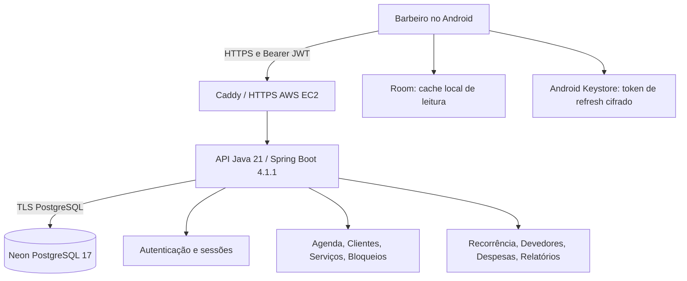

# Arquitetura e operação — Agenda Barber 1.0.0

[← README](../README.md) · [Desenvolvimento](DEVELOPMENT.md) · [Runbook de release](RELEASE_1_0_0_RUNBOOK.md)

## Limites do produto

**Único operador do APK:** o barbeiro autenticado. Não existe sistema de autoagendamento para clientes, portal público nem acesso direto ao banco pelo Android.

## Componentes

| Parte | Responsabilidade |
|---|---|
| Android / Compose | Navegação, formulários, indicadores, estado de carregamento/erro e fluxos manuais do barbeiro |
| Retrofit | Requisições HTTP autenticadas, serialização JSON e tratamento de falhas |
| Room | Cache local de **leitura**, com última sincronização quando disponível; não constitui fila transacional offline |
| Android Keystore | Chave local AES-GCM não exportável que protege o refresh token. Senha não é persistida |
| Spring Security | Validação JWT (RS256), autenticação, autorização e separação de operações |
| Serviços backend | Agenda, serviços, clientes, expediente, despesas, devedores, recorrência e relatórios |
| Neon PostgreSQL | Persistência de dados por barbeiro, histórico e regras de integridade |
| Flyway | Migrações SQL versionadas; execução controlada com credencial distinta da aplicação |
| Caddy / EC2 | HTTPS, proxy reverso e contêineres separados DEV/PROD |

## Domínio de dados (visão simplificada)

- `users`, `barbers`, `auth_refresh_tokens`: identidade do profissional e sessões.
- `clients`, `services`, `working_hours`, `blocked_periods`: catálogo e disponibilidade.
- `appointments`, estruturas de recorrência e eventos: atendimentos, status e histórico.
- `expenses`, registros de recebimento, `client_debt_entries`: resultados financeiros.
- `idempotency_records`: proteção contra duplicidade nas operações suportadas.

O backend consulta e modifica registros com `barber_id` derivado do JWT, nunca informado pelo cliente como autoridade. Chaves estrangeiras compostas reforçam a separação. A regra PostgreSQL `EXCLUDE` protege horários de agendamentos ativos contra sobreposição.

## Contratos e regras de negócio

### Autenticação

- Login por nome de usuário/senha. `POST /api/v1/auth/login`.
- JWT de acesso de curta duração, com refresh token opaco e rotativo (`POST /api/v1/auth/refresh`). Logout (`POST /api/v1/auth/logout`), perfil autenticado (`GET /api/v1/auth/me`).
- O servidor guarda hash do token de refresh, não o token puro. Reutilização indevida aciona revogação da família.
- **Lembrar conta**: app cifra somente o token de refresh usando Keystore; ao abrir, tenta recuperar sessão. Se inválida/revogada, exige login; falhas transitórias não devem ser tratadas como senha incorreta.

### Clientes

- `GET /api/v1/clients` com `search`, `filter`, `limit` e `offset`; `POST /api/v1/clients`; `PATCH /api/v1/clients/{id}`; `DELETE /api/v1/clients/{id}`.
- `DELETE` define `active=false`; preserva atendimentos concluídos e registros de dívida.
- Se o cliente possui agendamentos `SCHEDULED` / `IN_PROGRESS` ou saldo devedor positivo, a API responde **409 Conflict**. Cliente de outro barbeiro retorna **404**.

### Agenda e recorrência

- Reserva, atualização e cancelamento autenticados com proteção transacional, verificações de disponibilidade e status.
- Recorrência semanal permite pré-configurar dia/horário para clientes fixos, respeitando conflitos e limitações definidas pela API. Ver [agendamentos](APPOINTMENTS_API.md) e [recorrências](APPOINTMENTS_ANDROID.md).

### Financeiro e relatórios

- Devedores são registrados em livro de lançamentos de cobrança/pagamento, com saldo derivado da soma.
- Faturamento considera valor **efetivamente recebido**, não necessariamente o preço cadastrado. Cancelamentos não contam como receita.
- Lucro estimado = receitas recebidas − despesas elegíveis; não é fechamento contábil.

## Infraestrutura real

| Ambiente | Acesso | Execução |
|---|---|---|
| Produção | `https://prod-18-216-115-216.sslip.io/` | Docker Compose `agenda-barber-prod`, loopback `127.0.0.1:8081`, Caddy HTTPS |
| Desenvolvimento | `https://18-216-115-216.sslip.io/` | Docker Compose `deploy`, loopback `127.0.0.1:8080`, Caddy HTTPS |
| Dados | Neon PostgreSQL 17 | Branches `production` e `development` independentes |

A versão de backend implantada em produção em 07/11/2026 foi construída do commit `5977498` (imagem `agenda-barber-prod:1.0.0-5977498`). Status operacional exige conferência ao vivo; essa referência é registro de release, não monitoramento contínuo.

O hostname `sslip.io` depende do IPv4 público da EC2. Para produção duradoura, usar domínio próprio/gerenciado e política de IP estável; rever custo e certificados antes de migrar.

## CI, release e rollback

1. CI: Maven verify, Checkstyle, JUnit/Testcontainers, ktlint, testes Android, Android Lint e builds.
2. Segurança: inspeção de fonte e segredos; validação de assinatura **com chave efêmera na CI** apenas para smoke.
3. Release real: usar keystore oficial local, com senhas fora do Git; `assembleRelease` com `AB_PROD_API_URL` HTTPS oficial.
4. Checar `apksigner verify --print-certs`, package `com.agendabarber.app`, SHA-256 e versão.
5. Implantação da API é separada de merge e da assinatura Android; imagem/Compose anterior ficam disponíveis para rollback.
6. Não modificar Neon automaticamente em rollback de binário; restauração de dados requer plano e verificação em branch separada.

**Segredos:** nunca comitar `.env`, JDBC URL com senha, chaves JWT privadas, arquivos `.jks`, senhas de assinatura, tokens ou dados pessoais. Não registrar credenciais em logs e não publicar senhas de teste.
