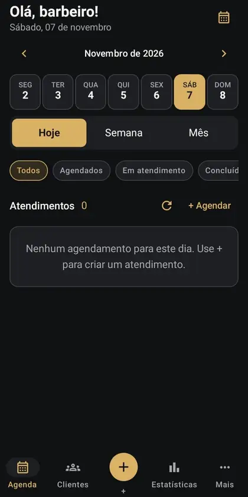
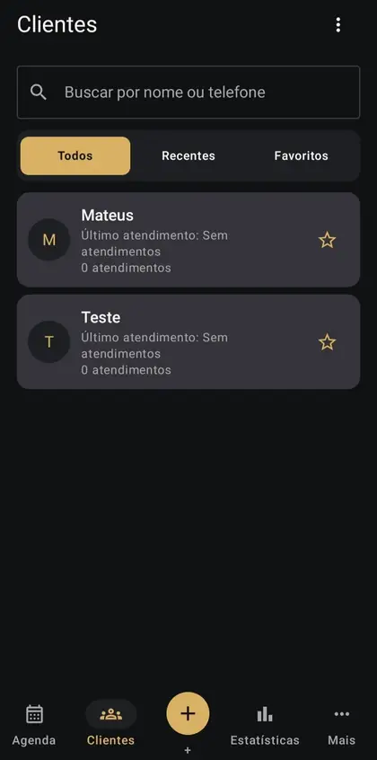
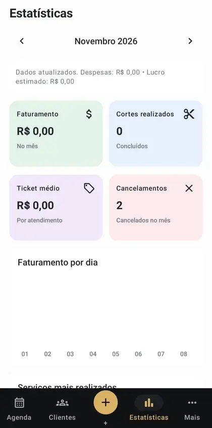
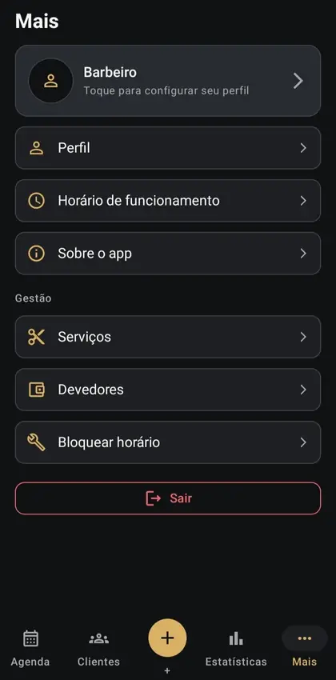
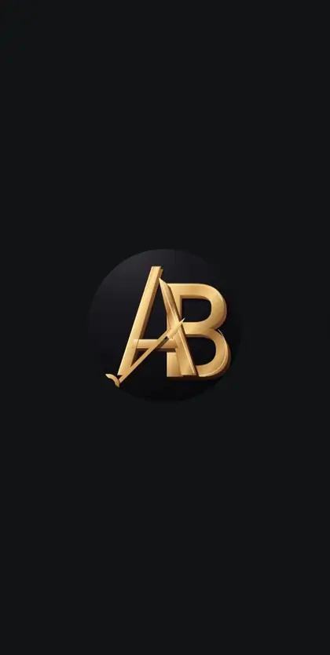

# Agenda Barber 1.0.0 — galeria de telas

Capturas reais da versão Android, fornecidas durante a homologação em **07/11/2026**. As imagens mostram estados pontuais da interface: valores, data, quantidade de clientes e número de atendimentos não representam dados demonstrativos fixos nem garantias do ambiente atual.

[← Voltar ao README](../README.md) · [Arquitetura](ARCHITECTURE.md) · [UX / design system](ux/DESIGN_SYSTEM.md)

## 1. Agenda

Abertura em **Agenda** com seleção semanal de datas, alternância **Hoje / Semana / Mês**, filtro de situação e ações para **atualizar** e **+ Agendar**. O estado vazio orienta a criação do primeiro atendimento. Selecionar uma data modifica o recorte apresentado, sem misturar os atendimentos de todos os dias.

## 2. Clientes

Exibe pesquisa por **nome ou telefone**, filtros **Todos / Recentes / Favoritos**, cartões por cliente, contagem e data do último atendimento e estrela de favoritos. Ao tocar em um cadastro, abre detalhes; o fluxo **Remover cliente** exige confirmação, mantém histórico (soft delete) e a API bloqueia exclusão se houver agendamentos abertos ou saldo devedor.

## 3. Estatísticas

Período mensal navegável, indicadores de **faturamento**, **cortes realizados**, **ticket médio**, **cancelamentos**, informações de **despesas / lucro estimado** e gráficos/serviços. Os cartões refletem os dados realmente retornados pela API. A captura mostra esta tela com visual claro; não se trata de um mockup dark.

## 4. Mais / Configurações

Acesso a **perfil do barbeiro**, **horário de funcionamento**, **sobre o app**, **serviços**, **devedores**, **bloquear horário** e **sair**. O botão Sair deve encerrar a sessão no aparelho; a API tenta revogar a sessão quando há conectividade.

## 5. Login

Acesso com **nome de usuário e senha**, botão para revelar a senha durante digitação e caixa **Lembrar conta**. O aplicativo não guarda a senha para relogar: quando marcado, persiste apenas o **refresh token criptografado** com Android Keystore e restaura a sessão automaticamente dentro da validade. A URL da API não é digitada pelo usuário.

## 6. Abertura / Splash

Tela de entrada dark com o monograma **AB** em dourado. Faz parte da identidade visual oficial do aplicativo.

## Fluxos não fotografados nesta galeria

As imagens recebidas cobrem as **seis telas acima**. Outros fluxos implementados, como **Novo agendamento**, **Novo cliente**, **Serviços**, **Horário de funcionamento**, **Devedores** e **Bloquear horário**, são documentados em [mapeamento de telas](ux/SCREENS.md), [agendamentos](APPOINTMENTS_ANDROID.md) e [contratos API](CLIENTS_API.md). Não apresentar imagens fictícias como capturas dessas telas.

## Uso das imagens

As capturas foram fornecidas pelo responsável pelo projeto para documentação do repositório. Nomes, datas e valores visíveis devem ser tratados como exemplos de estado da aplicação. Antes de divulgar novos prints, evite expor telefones, senhas, tokens e dados pessoais de clientes reais.
